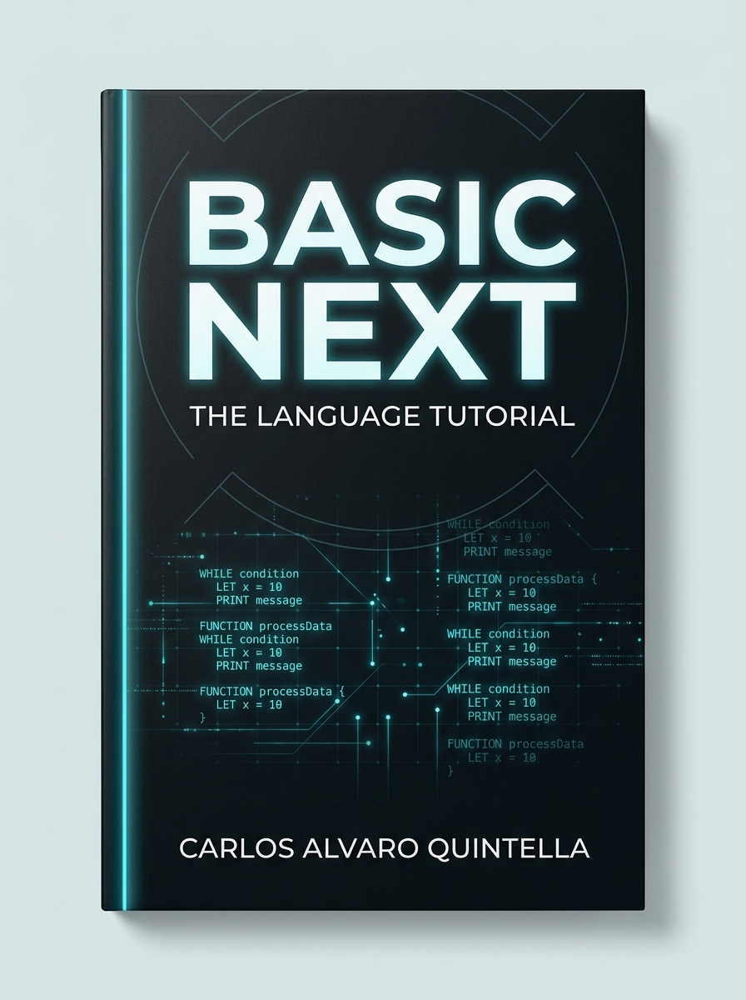

# Getting Started

[← Previous: Preface](00_preface.md) · [Contents](toc.md)

**Author:** Carlos Quintella  
**License:** Mozilla Public License 2.0 (MPL-2.0)



> **Note:** This tutorial covers the **0.6 line** of Basic Next, checked against the 0.6.10 toolchain. The normative specification lives in [`language/0.6/0.6.md`](https://github.com/cquintella/BasicNext/blob/v0.6.10/language/0.6/0.6.md), with the grammar in [`0.6.ebnf`](https://github.com/cquintella/BasicNext/blob/v0.6.10/language/0.6/0.6.ebnf) and the reserved word list in [`keywords.md`](https://github.com/cquintella/BasicNext/blob/v0.6.10/language/0.6/keywords.md). Official releases, documentation, and news are published at [http://basicnext.org](http://basicnext.org).

This chapter installs the toolchain, writes a first program, checks it, runs it with the interpreter, compiles it to a native executable, and reads the message the compiler gives when a program is wrong. Everything else in the book builds on these four steps.

## Installing the Toolchain

The toolchain is three programs: `bni` checks and interprets programs, `bnc` compiles them to native executables, and `bnr` is an interactive read-eval-print loop. Prebuilt releases for Linux, macOS, and Windows are published on [GitHub Releases](https://github.com/cquintella/BasicNext/releases) and at [http://basicnext.org](http://basicnext.org).

On Linux and macOS, the install script downloads the latest release, verifies its checksums, and installs the programs, the standard-library modules, the diagnostics catalog, and the manual pages:

```sh
curl -fsSL https://raw.githubusercontent.com/cquintella/BasicNext/main/scripts/install.sh | bash
```

On Windows, in PowerShell:

```powershell
irm https://raw.githubusercontent.com/cquintella/BasicNext/main/scripts/install.ps1 | iex
```

### Building from Source

To build the toolchain from source with Rust:

```sh
git clone https://github.com/cquintella/BasicNext.git
cd BasicNext
cargo build --release -p bni -p bnc -p bn_rt
```

Copy or link the resulting binaries (`target/release/bni` and `target/release/bnc`) to a directory on your `PATH`, such as `~/.local/bin` or `/usr/local/bin`.

### Verifying the Installation

```sh
$ bni --version
bni 0.6.10
$ bnc --version
bnc 0.6.10
```

## A First Program

Basic Next source files use the `.bn` extension and are UTF-8 text. Create a file named `hello.bn`:

```basic
// A minimal Basic Next program
FUNCTION Start() AS VOID
    PRINT "Hello, World!"
END FUNCTION
```

### Checking the Code

`bni check` reads the program and verifies its syntax and types without running it:

```sh
$ bni check hello.bn
hello.bn: lexical, syntax, and semantic checks passed
```

### Running with the Interpreter

`bni run` checks the program and then executes it:

```sh
$ bni run hello.bn
Hello, World!
```

### Compiling to a Native Executable

`bnc` checks the same program and compiles it to a native binary:

```sh
$ bnc hello.bn -o hello
$ ./hello
Hello, World!
```

By default the binary runs on any processor of the same architecture. `--cpu native` tunes it for the machine that compiles it:

```sh
$ bnc --cpu native hello.bn -o hello
```

Such a binary may not start on another processor, so keep the default for anything you distribute. The output does not change: `--cpu native` never alters a result, and floating-point arithmetic stays exactly as `bni` computes it.

### Understanding the Structure

* `// A minimal ...` is a comment. It runs to the end of the line.
* `FUNCTION Start() AS VOID` declares the entry point. Every executable program has a parameterless function named `Start`; the program begins there. `VOID` says the function returns no value. Functions are the subject of [chapter 5](05_functions.md).
* `PRINT` writes its arguments to standard output, followed by a newline.
* `END FUNCTION` closes the function.

Code always lives inside a function: a statement written outside one, at the top of the file, is a syntax error (`E0100`, "Expected IMPORT or a top-level declaration").

## Syntax Conventions

Two conventions are visible in the first program and hold everywhere in the language.

**Keywords are uppercase.** `FUNCTION`, `PRINT`, `END`, and the names of the built-in types (`INTEGER`, `FLOAT`, `BOOLEAN`, `STRING`, `VOID`) are written in capitals. Only the uppercase spelling is a keyword; `let` is an ordinary name, so a statement written in lowercase does not parse:

```text
error[E0101]: Syntax error: unexpected token after expression.
```

The names you create — variables, functions, classes — are case-sensitive and are usually written in camelCase or PascalCase, which keeps the language's words and the program's words visually apart. [Chapter 2](02_values_types_and_variables.md) gives the rules for names.

**Every block ends with an explicit `END`.** A function closes with `END FUNCTION`, a condition with `END IF`, a loop with `END WHILE` or `END FOR`. Indentation carries no meaning to the compiler; the `END` does. A misplaced line therefore produces a syntax error rather than a silently different program.

## Interpreter and Compiler

A program written in a programming language cannot be executed by the processor as it stands; it must first be analysed and then either executed by another program or translated. An *interpreter* reads a program and carries out its instructions directly, without producing a separate executable: it starts at once and makes the program easy to inspect, at some cost in speed. A *compiler* translates the whole program, ahead of time, into *machine code* for a particular processor, producing an executable file that runs without the compiler and usually faster. Both begin with the same analysis — reading the text, checking its syntax and types — performed by what is called the *frontend*; they differ in their *backend*, the part that executes or translates the result. Basic Next provides both, and makes them share everything up to the backend.

Both tools share one frontend. A program is read, checked, and lowered to a validated intermediate representation (BN IR); the interpreter executes that representation, and the compiler translates the same representation to machine code through LLVM:

```
[ Source .bn ]
      │
      ▼
[ Frontend: Lexer + Parser + Semantic Analysis ]
      │
      ▼
[ Validated BN IR ]
      ├──► bni (Reference Interpreter / LSP / DAP)
      └──► bnc (LLVM Compiler ──► Native Binary)
```

* `bni` is the executable reference of the language specification. It needs no external compiler, starts immediately, and also powers the editor tooling (`bni lsp`, `bni dap`).
* `bnc` produces a native executable that needs no interpreter at run time. When a feature cannot be represented faithfully on the target, `bnc` rejects the program with a support diagnostic rather than emitting code that behaves differently from `bni`. This edition publishes no benchmarks; measure the speed of either backend on your own workload.

## Toolchain Commands

| Command | Description |
| --- | --- |
| `bni check <file.bn>` | Runs the lexer, parser, and semantic analysis without executing code. |
| `bni run <file.bn> [-- args]` | Validates the program and executes `Start` in the interpreter. |
| `bnc <file.bn> [-o output]` | Compiles the program into a native binary. |
| `bni eval '<source>'` | Evaluates a short fragment of source. |
| `bni lex <file.bn>` | Prints the tokens produced by the lexer. |
| `bni lsp` | Serves the Language Server Protocol on standard input and output. |
| `bni dap` | Serves the Debug Adapter Protocol on standard input and output. |
| `bnr` | Opens the interactive read-eval-print loop. |

Exit codes follow a standard convention: `0` indicates success, `1` a compilation or language diagnostic error, and `2` invalid command-line flags or missing external tooling.

## Reading a Diagnostic

When a program breaks a rule, the compiler names the rule, the place, and what it expected. Here an `INTEGER` is assigned to a `FLOAT` binding, which Basic Next does not do implicitly:

<!-- bn-check: expect-error -->
```basic
FUNCTION Start() AS VOID
    LET a AS INTEGER = 10
    LET b AS FLOAT = a
    PRINT b
END FUNCTION
```

`bni check program.bn` reports:

```
error[TYPE_MISMATCH]: Type mismatch: Expected FLOAT64, but found INT32 in binding initializer.
 --> program.bn:3:22
  |
  3 |     LET b AS FLOAT = a
  |                      ^ incompatible value
  = cause: the value does not satisfy the operation's type contract
  = help: convert the value or change the receiving declaration to the expected type
```

Every diagnostic contains:

* **Severity:** `error` or `warning`.
* **Code:** a stable identifier, such as `TYPE_MISMATCH`, that the book and the specification use to name the rule.
* **Message:** what was expected and what was found. `INTEGER` and `FLOAT` appear as `INT32` and `FLOAT64`, the widths they stand for ([chapter 2](02_values_types_and_variables.md)).
* **Location:** the file, line, and column, with a `^` under the offending text.
* **Cause and help:** why the rule applies and what usually fixes it.

The fix here is an explicit conversion, which [chapter 3](03_operators_and_conversions.md) covers:

```basic
LET b AS FLOAT = a AS FLOAT
```

Each chapter ends with a table of the diagnostics it introduced, and [Appendix B](appendices.md#appendix-b-language-diagnostics) collects them all.

## Configuring Your Editor

Official plugins provide syntax highlighting, indentation, automatic uppercase conversion of keywords, and diagnostics from `bni check` as you edit.

### Vim and Neovim (`basicnext-vim`)

For Vim:

```sh
mkdir -p ~/.vim/pack/plugins/start
git clone https://github.com/cquintella/basicnext-vim.git ~/.vim/pack/plugins/start/basicnext-vim
```

For Neovim:

```sh
mkdir -p ~/.local/share/nvim/site/pack/plugins/start
git clone https://github.com/cquintella/basicnext-vim.git ~/.local/share/nvim/site/pack/plugins/start/basicnext-vim
```

The plugin:

* detects `*.bn` files as `filetype=basicnext`;
* capitalizes keywords when you type a space or delimiter (turn it off with `let g:basicnext_auto_caps = 0`);
* runs `bni check` on `:make` and fills the quickfix list;
* connects to `bni lsp` through `vim-lsp` or `coc.nvim`.

### Visual Studio Code (`basicnext-vscode`)

The extension provides syntax highlighting, diagnostics on save, snippets, and debugging through `bni dap`. Install it from a clone of its repository:

```sh
git clone https://github.com/cquintella/basicnext-vscode.git
cd basicnext-vscode
npx --yes @vscode/vsce package --allow-missing-repository
code --install-extension basicnext-*.vsix
```

The main settings are:

* `basicnext.executable`: path to the `bni` binary (found on `PATH` by default);
* `basicnext.compilerExecutable`: path to the `bnc` binary;
* `basicnext.checkOnSave`: runs `bni check` on save and shows the result in the Problems view (on by default);
* `basicnext.autoUppercaseKeywords`: uppercases keywords as you type (on by default).

`Cmd+F5` (or `Ctrl+F5`) runs the active `.bn` file with `bni run` in the integrated terminal. Debugging is covered in [chapter 16](16_debugging_and_profiling.md).

## Diagnostics Introduced in This Chapter

| Diagnostic | Raised when |
| --- | --- |
| `E0100` | A statement appears outside a function, at the top of the file. |
| `E0101` | The source does not follow the grammar, for example a keyword written in lowercase. |
| `TYPE_MISMATCH` | A value of one type is used where another is required. |

## Summary

The toolchain gives three views of the same program. `bni check` verifies it without running it, `bni run` executes it in the reference interpreter, and `bnc` compiles it to a native executable; all three start from one validated representation, so a program the checker accepts means the same thing to both backends. Every program begins at `FUNCTION Start`, and every statement lives inside a function. Keywords are written in uppercase and every block closes with an explicit `END`, which keeps the structure of a program visible without relying on indentation. When a program breaks a rule, the diagnostic names the rule with a stable code, points to the place, and states what was expected — information the rest of the book uses to explain each rule as it is introduced.

The next chapter begins the language proper, with the values a program computes and the bindings that hold them.

---

[Next: Values, Types and Variables →](02_values_types_and_variables.md)
